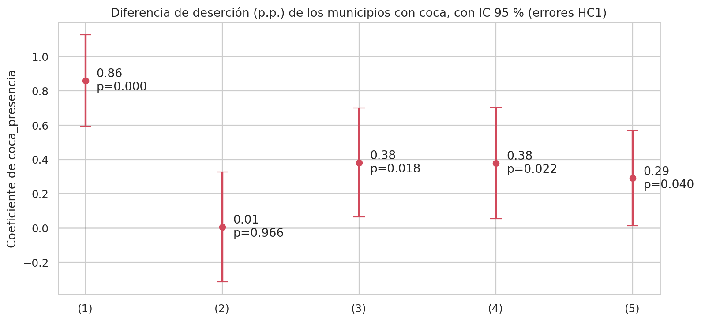

# 📌 Coca y deserción escolar en los municipios de Colombia: asociación y predicción

**Autores:** Daniel Peña, Santiago González y Sebastián Mendoza

Proyecto final de Inteligencia Artificial con Aplicaciones en Economía I, Facultad de Economía, Universidad Externado de Colombia. Docente: Lina María Castro.

## 🌍 Descripción corta y relevancia económica

Los programas de persistencia escolar(alimentación escolar, transporte, becas) se enfocan en variales como la pobreza la ruralidad. Nuestro Proyecto se cuestiona si la economia cocalera concentra desercion por encima esos criterios que la explican. Lo hacemos con dos preguntas a nivel municipal: si la presencia, la intensidad y la persistencia de la coca que se asociacian con mas desercion interannual cuando comparamos municipios con caracteristicas similares, estas variables sirven para predecir que municipios tendran desercion alta en 2022-2024. Para la asociacion nosostros usamos una regresion lineal MCO con errores robustos). Para la prediccion comparamos una regresion logistica, KNN, arbol de decision, random forest y XGBoost, para describer los territories usamos PCA y K-Means.

Nuestro hallazgo mas importante es que la coca en efecto se asocia con más deserción, 0,38 puntos porcentuales dentro del mismo departamento y con todos los controles, pero apenas mejora la predicción: su información está en el conflicto, el PDET y el departamento. Lo que mayormente predice la deserción elevada es la historia escolar del municipio en si. El mejor modelo, la Regresión Logística, llega a una PR-AUC de 0,71 sin historial de deserción y de 0,75 con él, frente a 0,25 de un clasificador al aleatorio. Los resultados son asociaciones, no efectos causales.

## 📂 Estructura del repositorio

```
proyecto_desercion_coca/
├── data/
│   ├── raw/                            # Bases originales sin modificar, con los metadatos de datos.gov.co
│   └── processed/                      # Panel municipio-año, serie de coca y base municipal (los crean los notebooks)
├── notebooks/
│   ├── 01_limpieza_union.ipynb         # Etapa 1: importación, inventario de columnas, limpieza y uniones auditadas
│   ├── 02_variables_eda_kmeans.ipynb   # Etapa 2: división train/test, construcción y selección de variables, EDA, PCA y K-Means
│   └── 03_modelado.ipynb               # Etapa 3: asociación (MCO) y modelos de clasificación con su evaluación
├── src/
│   ├── config.py                       # Rutas, años y direcciones de las fuentes
│   └── 01_carga_datos.py               # Descarga de las bases desde datos.gov.co y el DANE (opcional)
├── outputs/
│   ├── figures/                        # Gráficos generados por los notebooks (fig00 a fig20)
│   └── reports/                        # Inventarios, auditoría de uniones, registro de limpieza y métricas de los modelos
├── docs/                               # Documento de análisis (Word/PDF) y presentación (PDF)
├── run_all.py                          # Ejecuta los tres notebooks en orden y guarda sus salidas
├── README.md                           # Este archivo
└── requirements.txt                    # Librerías y versiones necesarias
```

## ⚙️ Instrucciones de reproducibilidad (paso a paso)

Se necesita Python 3.13 y Git.

1. **Clonar el repositorio:**

   ```bash
   git clone <URL_DEL_REPOSITORIO>
   cd proyecto_desercion_coca
   ```

2. **Crear y activar el entorno virtual:**

   ```bash
   python -m venv env
   ```

   - Windows: `env\Scripts\activate`
   - macOS o Linux: `source env/bin/activate`

3. **Instalar las dependencias:**

   ```bash
   pip install -r requirements.txt
   ```

4. **Orden de ejecución.** Los notebooks se corren en este orden, porque cada uno usa lo que guarda el anterior:

   1. `notebooks/01_limpieza_union.ipynb` (etapa 1). Carga las seis bases de `data/raw/`, hace el inventario de todas sus columnas y limpia cada fuente: el MEN (código DANE con cero inicial, separadores de miles, rangos), la coca 2001-2024 (celdas vacías = 0 ha), las víctimas (un solo corte), el IPM y sus privaciones, la población por área y los municipios PDET. También evalúa el PAE. Luego une todo por código DANE, revisando las filas en cada unión, y guarda el panel municipio-año en `data/processed/`.
   2. `notebooks/02_variables_eda_kmeans.ipynb` (etapa 2). Construye la variable objetivo y los predictores (coca, conflicto, pobreza, territorio y MEN rezagado a 2019-2021) y arma la base municipal. Después divide en train y test y evalúa cada variable candidata solo con train. Hace el EDA con sus hallazgos (IPM, persistencia de la deserción, dinámica de la coca, Nariño), el PCA sobre las 15 privaciones y el K-Means, y guarda la base municipal.
   3. `notebooks/03_modelado.ipynb` (etapa 3). En la parte A estima las regresiones de asociación (MCO con errores robustos y VIF). En la parte B resuelve las decisiones de modelado con validación cruzada, busca los hiperparámetros de los cinco modelos en dos escenarios, revisa el sobreajuste y la estabilidad de los pliegues y mide el aporte marginal de la coca. Al final elige el campeón, fija el umbral, evalúa en el test (matriz de confusión, curvas ROC y precisión-recall) e interpreta con odds ratios, importancia por permutación y SHAP. Las métricas quedan en `outputs/reports/` y las figuras en `outputs/figures/`.

   Los notebooks se pueden abrir en VS Code o Jupyter con el kernel del entorno `env`. También se pueden correr los tres de una vez desde la terminal, en unos 3 minutos:

   ```bash
   python run_all.py
   ```

Las bases ya vienen en `data/raw/`, así que no hace falta descargarlas. Si se quieren volver a descargar de las fuentes oficiales se usa `python run_all.py --descargar`; la base de víctimas tarda unos 4 minutos por año en el servidor.

Todas las rutas son relativas a la raíz del proyecto, y la semilla es `42` en la división de datos, la validación cruzada, el PCA, el K-Means y los modelos, así que dos ejecuciones desde cero dan los mismos resultados. Los notebooks también corren en Google Colab: se sube la carpeta a "Mi unidad" de Drive y la primera celda la encuentra sola.

## 📊 Datos y fuentes

La unidad de observación es el **municipio** (código DANE de 5 dígitos). La base final tiene **1.121 municipios** y 88 columnas (`data/processed/base_municipal.csv`), y sale de un panel municipio-año de 15.704 filas y 67 columnas.

| Base | Fuente | Filas × columnas | Unidad de observación | Enlace |
| --- | --- | --- | --- | --- |
| Estadísticas en educación preescolar, básica y media por municipio, 2011-2024 | Ministerio de Educación Nacional | 15.707 × 41 | Municipio-año | [datos.gov.co/d/nudc-7mev](https://www.datos.gov.co/d/nudc-7mev) |
| Detección de cultivos de coca (hectáreas), 2001-2024 | Ministerio de Justicia y del Derecho (SIMCI) | 319 × 28 | Municipio con coca en algún año | [datos.gov.co/d/acs4-3wgp](https://www.datos.gov.co/d/acs4-3wgp) |
| Víctimas por años municipal, corte 31/08/2026 (agregada) | Unidad para las Víctimas | 2.997 × 4 | Municipio-año | [datos.gov.co/d/m64i-rnss](https://www.datos.gov.co/d/m64i-rnss) |
| Municipios PDET | Agencia de Renovación del Territorio | 170 × 6 | Municipio PDET | [datos.gov.co/d/idrk-ba8y](https://www.datos.gov.co/d/idrk-ba8y) |
| Pobreza multidimensional municipal, censo 2018 (4 hojas: IPM y 15 privaciones, total y por zona) | DANE | 1.122 × 72 | Municipio | [Anexo DANE](https://www.dane.gov.co/files/investigaciones/condiciones_vida/pobreza/2018/informacion-censal/anexo-censal-pobreza-municipal-2018.xlsx) |
| Población municipal por área, 2018-2042 | DANE | 84.229 × 7 | Municipio-año-área | [Anexo DANE](https://www.dane.gov.co/files/censo2018/proyecciones-de-poblacion/Municipal/PPED-AreaMun-2018-2042_VP.xlsx) |

La variable objetivo es `desercion_alta`: vale 1 si la deserción intraanual promedio del sector oficial en 2022-2024 supera el percentil 75 (4,76 %), lo que deja al 25 % de los municipios en la clase positiva. Los predictores se miden entre 2021 y 2023; las variables del MEN entran rezagadas a 2019-2021 para evitar fuga de información.

## 🏆 Resultados clave

- **Asociación.** La coca se asocia con 0,38 puntos porcentuales más de deserción cuando se comparan municipios del mismo departamento con todos los controles (p = 0,018), y con 0,29 puntos aun controlando por la deserción de 2019-2021 (p = 0,040). Sin el departamento la relación desaparece, porque Nariño y otros departamentos con mucha coca y poca deserción la esconden.
- **Predicción.** La Regresión Logística es el mejor modelo en validación cruzada (PR-AUC de 0,71 sin historial y 0,75 con historial). En el test, con el umbral elegido en train, detecta 42 de los 56 municipios de deserción alta, y Random Forest detecta 48.
- **Aporte de la coca.** Agregar las variables de coca cambia la PR-AUC entre -0,001 y +0,005 en los diez modelos, dentro de la variación normal entre pliegues.
- **Tipologías.** K-Means encuentra un grupo rural disperso de la Amazonía, Chocó y La Guajira con un riesgo de deserción alta (39 %) parecido al del grupo cocalero (41 %), aunque casi no tiene coca.



El detalle de cada resultado está en los notebooks 02 y 03, en `outputs/reports/` y en el documento de análisis de `docs/`.
